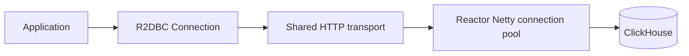

# Connection pooling

The driver already owns a Reactor Netty connection pool. Every R2DBC `Connection` created by one
`ClickHouseConnectionFactory` is a lightweight logical handle over that shared transport pool.
Most applications should use it directly and should not add `io.r2dbc.pool`.



## Default setup

For Spring Boot, configure the normal R2DBC URL and leave `spring.r2dbc.pool.enabled=false`:

```yaml
spring:
  r2dbc:
    url: r2dbc:clickhouse://localhost:8123/default
    username: default
    password: ""
    pool:
      enabled: false
```

The transport reuses physical HTTP connections automatically. Creating and closing an R2DBC
`Connection` does not create and close a TCP connection for every query.

## Transport pool options

Set these options only after observing pool saturation or connection-lifecycle requirements in
your own workload.

| R2DBC URL option | Meaning |
| --- | --- |
| `transportMaxConnections` | Maximum physical connections to one ClickHouse host |
| `transportPendingAcquireMaxCount` | Maximum queued acquisitions after the pool is full |
| `transportPendingAcquireTimeout` | Maximum wait for a pooled connection, as an ISO-8601 duration |
| `transportMaxIdleTime` | Maximum idle time before eviction |
| `transportMaxLifeTime` | Maximum total lifetime of a pooled connection |

Example:

```text
r2dbc:clickhouse://localhost:8123/default?transportMaxConnections=16&transportPendingAcquireTimeout=PT2S
```

When omitted, these settings follow Reactor Netty's defaults:

| Setting | Default |
| --- | --- |
| Maximum connections | `max(availableProcessors, 8) * 2` |
| Pending acquisitions | `500` |
| Acquisition timeout | `45s` |
| Idle and lifetime eviction | Disabled |

Increasing the pool is not automatically faster. It also increases the number of queries that can
execute concurrently on ClickHouse. Measure server load, pending acquisitions, and application
latency together before changing it.

## Decoder workers

Row decoding runs outside the Reactor Netty event loop because the current RowBinary reader uses a
blocking `InputStream`. By default, the number of decoder workers follows the physical connection
limit. This keeps decode admission and transport capacity aligned.

Two advanced options exist:

- `decoderWorkerCount` changes the decoder concurrency limit;
- `decoderUseVirtualThreads=true` uses bounded virtual-thread execution for decoding.

Leave both at their defaults unless a workload-specific measurement justifies changing them.
Widening decoder concurrency without also considering the pending-acquisition limit can move work
from one bounded queue to another or cause acquisition failures.

## Optional R2DBC-level pool

Add `io.r2dbc.pool` only when an integration explicitly requires SPI-level pooling, validation, or
eviction of logical R2DBC connections. It does not replace the driver's transport pool and creates
an additional lifecycle layer. See [Optional: io.r2dbc.pool](optional-r2dbc-pool.md).

## Shutdown

`ClickHouseConnectionFactory.dispose()` releases the shared transport pool and decoder scheduler.
Call it when the application shuts down. In Spring, register the raw factory as a bean with
`destroyMethod = "dispose"`.

If an outer `io.r2dbc.pool.ConnectionPool` is used, dispose both layers: first the outer pool, then
the underlying `ClickHouseConnectionFactory`.

## Related reference

- [Connection configuration](../reference/configuration.md)
- [Using with Spring Boot](../guide/spring-boot.md)
- [What fully reactive means](../concepts/fully-reactive.md)
